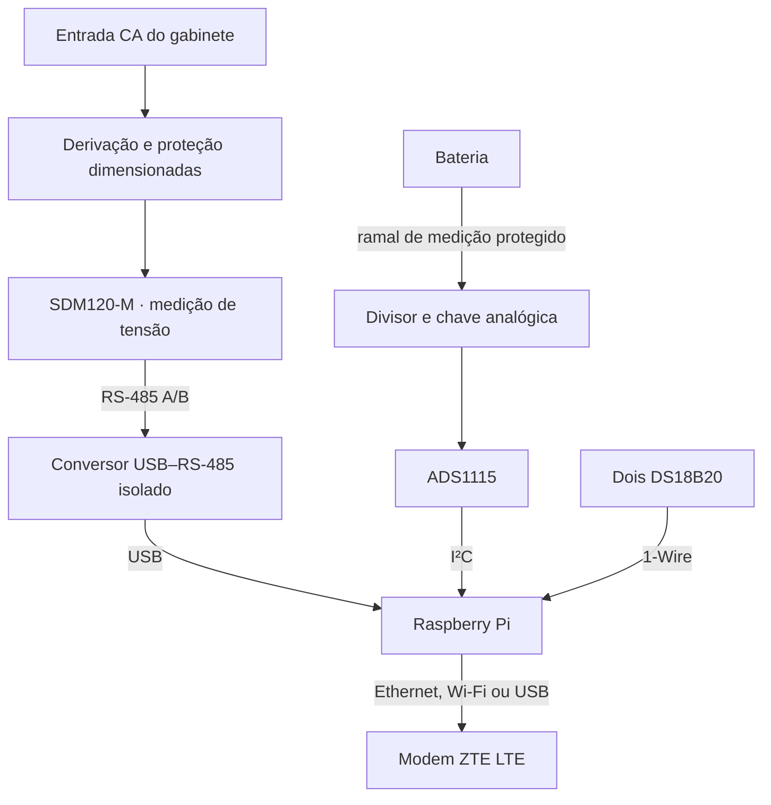

# Circuitos e montagem

Projeto de referência para um gabinete de automação, com alimentação CA nominal 110/127 ou 220 V, bateria nominal 12 V e dois pontos de temperatura. A entrada CA fica restrita ao medidor de trilho DIN. Montagem e comissionamento da parte CA por profissional habilitado/autorizado, com o circuito desenergizado e conforme NR-10, projeto elétrico do gabinete e manual da revisão comprada. Verifique a categoria de instalação, a proteção contra surtos, a segregação de circuitos e a compatibilidade com o esquema de aterramento.

## Entrada CA

Referência **Eastron SDM120-M com RS-485 Modbus RTU**, faixa publicada de 85 a 276 Vca, 50/60 Hz. Usar o medidor apenas no ramal de medição. O circuito de potência do gabinete segue seu projeto original.

| Ponto | Ligação de referência no SDM120-M |
|---|---|
| Condutor de fase protegido da derivação | Borne 1, L-in |
| Retorno da entrada de medição | Borne N de entrada, conforme desenho da revisão. Para 220 V fase-fase, confirmar expressamente com o fabricante a compatibilidade e aplicar proteção/seccionamento para ambos os condutores ativos |
| Borne 2, L-out | Sem carga nesta aplicação |
| RS-485 B− | Borne 9 para B− do conversor isolado |
| RS-485 A+ | Borne 10 para A+ do conversor isolado |
| USB do conversor | Raspberry Pi |

O adaptador deve ter isolamento galvânico também na alimentação do lado RS-485 e especificação de isolamento compatível com a instalação. Usar par trançado e seguir o manual do adaptador para blindagem, terminação e polarização. Confirmar os bornes pelo desenho da revisão antes da ligação. Não usar PE como retorno de medição.

Configure endereço 1, 9600 bit/s, 8N1. O código usa função 04, offset 0 (registro de referência 30001), float de dois registradores. O SDM120-M se alimenta do próprio circuito medido. Abaixo da faixa, pode parar de responder. O software grava leitura nula e código de falha. Para distinguir falta de CA de falha de comunicação é necessário um sensor independente de presença ou um medidor com alimentação auxiliar.

## Bateria CC

Este circuito de bancada é para um barramento de bateria de **terra comum aprovado no projeto do gabinete**, dentro de 0–30 Vcc em regime permanente. Confirmar que a referência da bateria pode ser unida ao GND do Pi, inclusive considerando a alimentação, o modem, portas USB e demais conexões. Para barramento flutuante, positivo aterrado ou ambiente com surtos não caracterizados, usar entrada CC galvanicamente isolada, dimensionada para a instalação. A entrada abaixo não é uma proteção industrial contra surtos ou inversão de polaridade.

| Nó | Ligações |
|---|---|
| Bateria positiva | Fusível CC junto ao ponto de derivação, depois R1 de 100 kΩ até DIV |
| DIV | R2 de 10 kΩ para GND, C1 de 100 nF para GND e entrada S1 do TMUX1511 |
| TMUX1511 | VDD e SEL1 a 3,3 V, VSS/GND ao GND, desacoplamento local de 100 nF. Manter os canais não usados desligados conforme datasheet |
| Saída D1 | AIN0 do ADS1115 e R3 de 1 MΩ para GND |
| Bateria negativa | GND comum, somente após validação do aterramento |
| ADS1115 | VDD em 3,3 V, GND comum, ADDR em GND (0x48), SDA e SCL no I²C do Pi. Desacoplar VDD com 100 nF se ausente no módulo |

A chave TMUX1511 isola o ADS1115 quando a alimentação de 3,3 V está desligada, dentro dos limites do datasheet da chave. Com a chave ligada, R2 em paralelo com R3 resulta em ganho nominal 11,1. AIN0 fica em aproximadamente 1,26 V a 14 Vcc e 2,70 V a 30 Vcc. A faixa do PGA de ±4,096 V determina a escala digital. A entrada continua limitada pela alimentação de 3,3 V. Verifique fuga, tolerâncias e comportamento nas transições de alimentação antes do uso em campo. Use bornes polarizados e dimensione o fusível CC pelo cabo, corrente de curto disponível e capacidade de interrupção.

## Raspberry Pi e temperatura

| Pino físico do Pi | Sinal | Ligações |
|---|---|---|
| 1 | 3,3 V | ADS1115, TMUX1511 e VDD dos dois DS18B20 |
| 3 | GPIO2/SDA | ADS1115 SDA |
| 5 | GPIO3/SCL | ADS1115 SCL |
| 6 | GND | Retorno dos sensores e do ADS1115 |
| 7 | GPIO4 | DQ dos dois DS18B20 em paralelo, com um pull-up de 4,7 kΩ para 3,3 V |

Usar DS18B20 com três fios e testar a pinagem da sonda pelo manual. Instalar a sonda interna no ar do gabinete e a externa em abrigo ventilado, à sombra, com prensa-cabos. Separar cabeamento de sensores dos condutores de potência. Usar barramento linear com derivações curtas e verificar CRC com o comprimento real instalado.

Para continuar monitorando numa falta de CA, alimentar Raspberry e modem por fonte com autonomia. No gabinete, prever conversor CC/CC regulado com entrada ampla compatível com a bateria, transientes e polaridade do local, saída conforme o modelo do Pi, proteção de ramal e corte por subtensão adequado à bateria. Verificar a alimentação própria do ZTE e o pico de corrente no registro LTE. Se o ZTE for USB, verificar o orçamento de corrente ou usar hub alimentado com proteção contra retorno.

## Lista de materiais

| Qtd. | Item | Critério |
|---|---|---|
| 1 | Raspberry Pi com conector GPIO de 40 pinos | Raspberry Pi OS e fonte dimensionada para o modelo |
| 1 | microSD de alta resistência ou SSD | Armazenamento local e fila |
| 2 | DS18B20 de três fios | Sondas interna e externa |
| 1 | Resistor 4,7 kΩ | Pull-up 1-Wire |
| 1 | Módulo ADS1115 | I²C a 3,3 V, endereço configurável |
| 1 | TMUX1511 e placa adaptadora | Condicionamento do canal CC |
| 1 de cada | Resistores 100 kΩ, 10 kΩ e 1 MΩ | 0,1% em R1 e R2 |
| 3 | Capacitores 100 nF | Filtro e desacoplamentos, contar os já presentes nos módulos |
| 1 | Eastron SDM120-M Modbus | Versão com RS-485 |
| 1 | Conversor USB–RS-485 isolado | Isolação de sinal e alimentação, suporte Linux |
| 1 | ZTE LTE e SIM com dados | Equipamento existente |
| Conforme instalação | Proteções CA/CC, caixas, trilho, bornes, pares trançados, prensa-cabos e fonte/backup | Dimensionar para o gabinete e ambiente |

## Comissionamento

1. Em bancada, valide alimentação, pinagem, endereços e leituras de cada sonda. Inspecione os 3,3 V durante ligar e desligar, inclusive com a bateria conectada.
2. Compare CC com multímetro em dois pontos, por exemplo 12 e 15 V. Com ganho inicial 11,1 e offset zero, obtenha a tensão de AIN0 dividindo a leitura bruta em volts de bateria por 11,1. Use ganho = diferença das leituras de referência ÷ diferença em AIN0. Use offset = primeira referência − ganho × primeiro AIN0.
3. Compare o valor no painel com o visor do medidor e com instrumento apropriado, nas tensões nominais aplicáveis ao gabinete. Verifique o comportamento com falha de CA e com RS-485 desconectado.
4. Desconecte o LTE, aguarde algumas amostras e reconecte. Confirme o histórico no horário de medição e exporte o CSV local para comparar.
5. Reinicie o Pi sem rede e confira coleta automática, conservação da fila e relógio. Para locais sem sincronização no boot, prever RTC com backup e acertar a hora antes do comissionamento.

## Referências

- [Eastron SDM120-M, ligação e mapa Modbus](https://www.eastrongroup.com/eastrongroup/2025/03/22/eastronsdm120-musermanualv1.0.pdf)
- [Texas Instruments ADS1115](https://www.ti.com/lit/ds/symlink/ads1115.pdf)
- [Texas Instruments TMUX1511](https://www.ti.com/lit/ds/symlink/tmux1511.pdf)
- [Analog Devices DS18B20](https://www.analog.com/media/en/technical-documentation/data-sheets/DS18B20.pdf)
- [NR-10, Ministério do Trabalho e Emprego](https://www.gov.br/trabalho-e-emprego/pt-br/acesso-a-informacao/participacao-social/conselhos-e-orgaos-colegiados/comissao-tripartite-partitaria-permanente/normas-regulamentadoras/normas-regulamentadoras-vigentes/norma-regulamentadora-no-10-nr-10)
